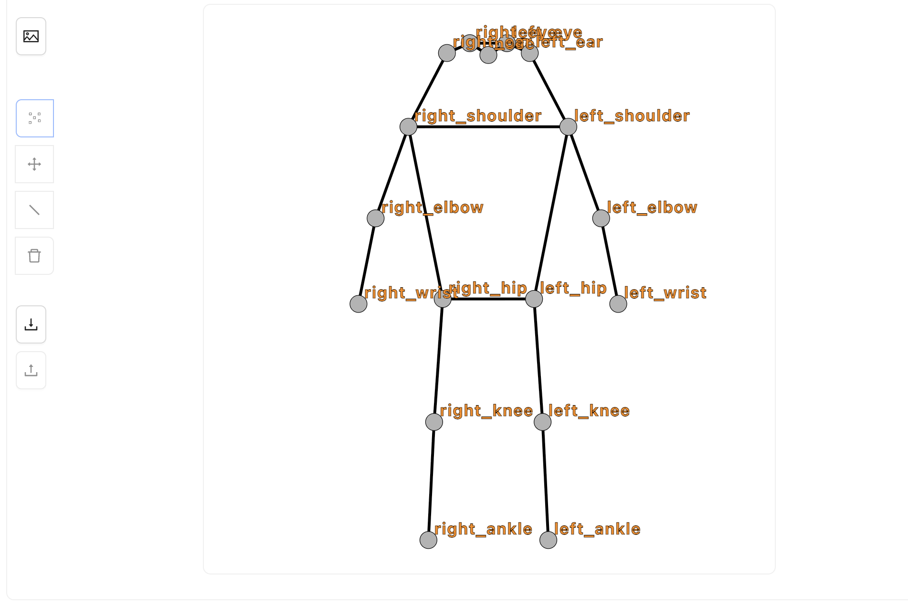
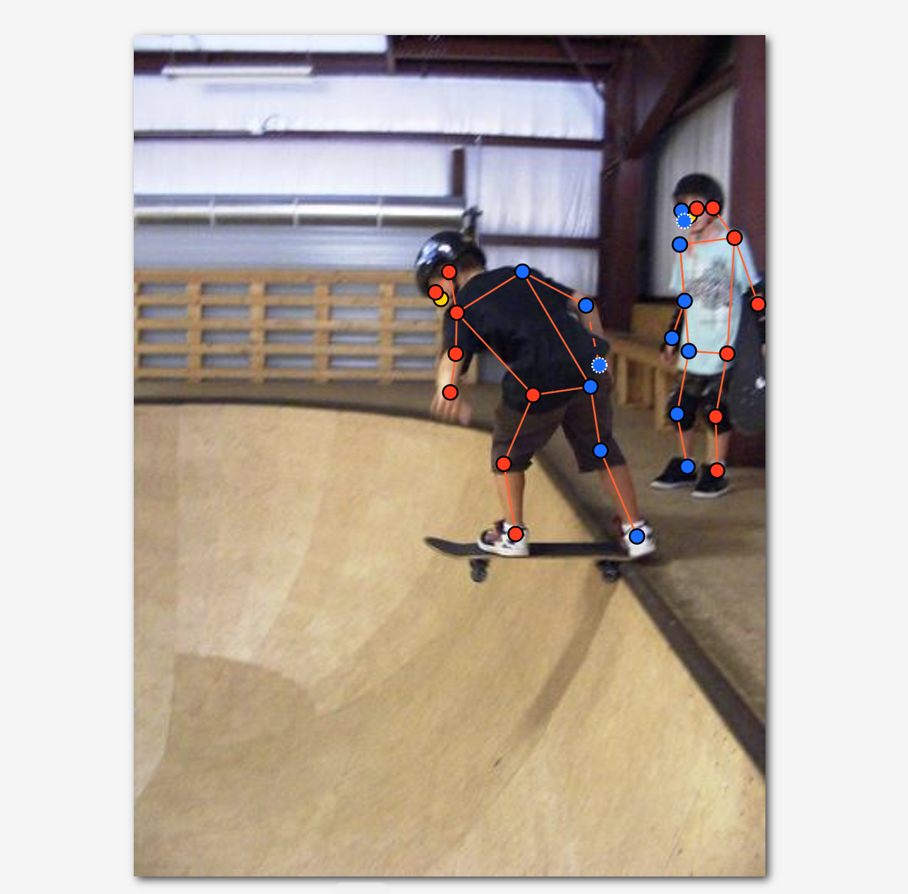
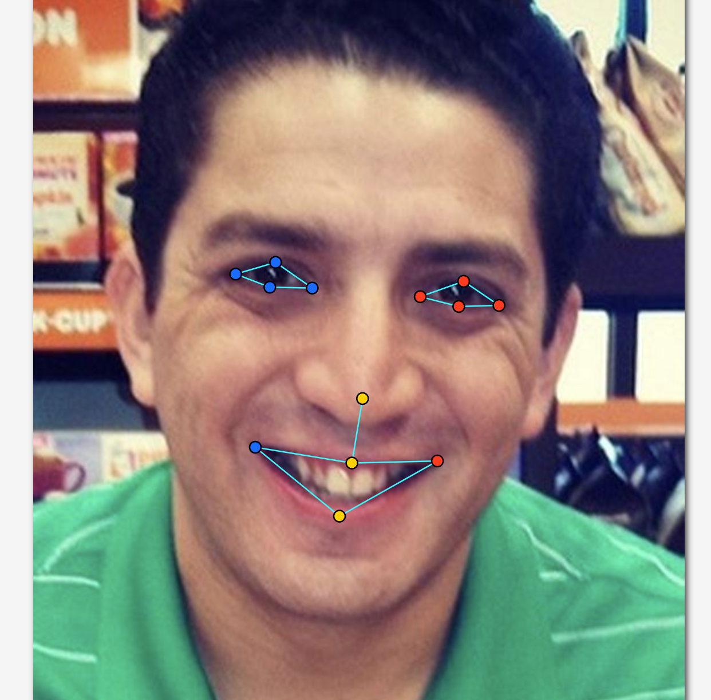
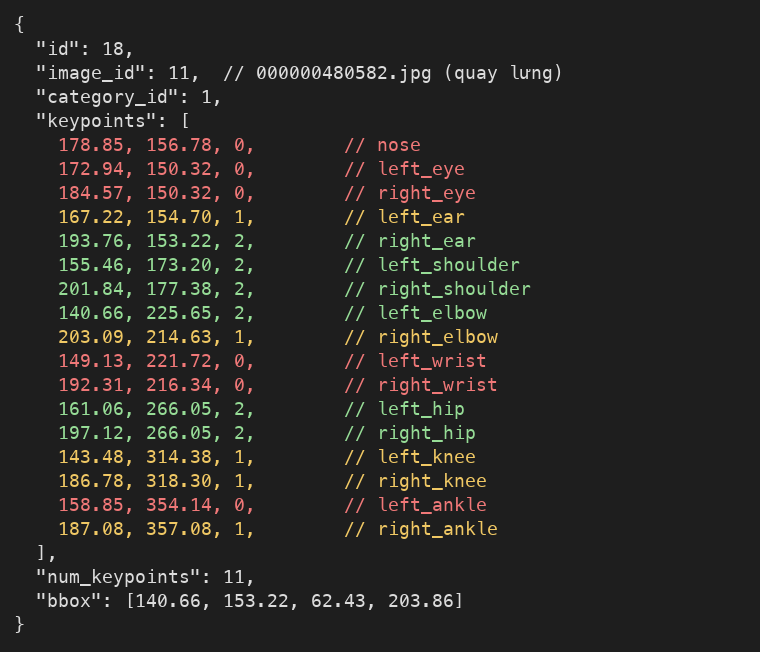

# Báo cáo cá nhân — LeTienBinh-2A202603346

Dữ liệu: 12 ảnh người COCO 2017 (Lin et al., 2014) và 8 ảnh khuôn mặt cắt từ ảnh COCO 2017 (CC BY / CC BY-SA), chỉ dùng trong lớp.

## 0. Thông tin học viên

- Họ tên: Lê Tiến Bình
- MSSV: 2A202603346
- Email: TODO
- Link repository: https://github.com/Cily49/K5-L2-DAY04-LeTienBinh-2A202603346-KeypointPose
- Phiên bản CVAT (Help → About): 2.82.1
- Máy: hệ điều hành macOS 26.5.1 · RAM 24 GB · chạy CVAT chế độ đầy đủ
- Bộ ảnh (`src/exports/assignment.json` do `lab.py setup` tạo): có
- Giờ bắt đầu: TODO
- Giờ kết thúc: TODO

## 1. Kiểm tra label (CP0)

| Label | Kiểu | Số điểm | Tên điểm đúng bảng của lab? | Đúng thứ tự? | Số cạnh |
|---|---|---:|---|---|---:|
| `person` | Skeleton | 17 | Có | Có | 19 |
| `face` | Skeleton | 13 | Có | Có | 13 |

Mẫu `person` dựng theo người quay mặt về camera (các điểm `left_*` nằm bên phải khung mẫu)? Có

Cách đổi cờ `occluded` / `outside` cho **một điểm** trên phiên bản CVAT này (một câu):

Rê chuột vào đúng một điểm của skeleton rồi bấm `Q` (bật/tắt `occluded`, `v = 1`) hoặc `O` (bật/tắt `outside`, `v = 0`), hoặc chuột phải vào điểm đó để mở menu outside · khóa · occluded · hidden; chỉ điểm đó đổi cờ, không dùng `hidden` vì không được lưu khi xuất.

## 2. Số lượng đã gán và thời gian (CP1, CP2)

| Nhóm ảnh | Số ảnh | Số skeleton đã gán | Số người dưới 60 px (không gán) | Số poster / gương / màn hình bỏ qua | Thời gian (phút) |
|---|---:|---:|---:|---:|---:|
| `easy` | 5 | 5 | TODO | TODO | TODO |
| `occluded` | 3 | 6 | TODO | TODO | TODO |
| `back` | 2 | 4 | TODO | TODO | TODO |
| `small` | 1 | 2 | TODO | TODO | TODO |
| `crowd` | 1 | 3 | TODO | TODO | TODO |
| `faces` | 8 | 8 | — | TODO | TODO |

- Số ảnh người đã xong ở mốc phút 105: TODO / 10
- Thời gian thực tế (phút): CP1 TODO · CP2 TODO · CP3 TODO
- Ảnh tốn thời gian nhất là ảnh nào, vì sao?

TODO

## 3. Bảng ca khó (CP1, CP2)

Mỗi điểm bạn phân vân một dòng, nhất là phân vân giữa `v = 1` và `v = 0`, hoặc không chắc hướng người.

| Ảnh | Người / mặt | Điểm | Cờ đã chọn | Phân vân giữa | Lý do chọn |
|---|---|---|---:|---|---|
| `000000150192.jpg` | Người 2 (ngồi phía sau, bên trái ảnh) | `right_ankle` | 1 | `v = 1` / `v = 0` | Bị gầm bàn che, nhưng dựa vào vị trí đùi nên xác định được cổ chân nằm ở đâu |
| `000000150192.jpg` | Người 2 (ngồi phía sau, bên trái ảnh) | `left_hip` | 0 | `v = 1` / `v = 0` | Bị che hoàn toàn, không có căn cứ nào để xác định vị trí |
| `000000150192.jpg` | Người 1 (áo caro, ngồi trước bàn) | `left_hip`, `right_hip` | 1 | `v = 1` / `v = 0` | Hông bị bàn che, nhưng dựa vào vị trí vai và ngực để suy ra được hông |
| `000000188804.jpg` | Người 2 (ngồi sau laptop) | `right_shoulder` | 0 | `v = 1` / `v = 0` | Bị vật phía trước che khuất, không xác định được vị trí |

## 4. Bảng tự review (CP3)

Đi từ ảnh cuối về ảnh đầu. 5 ảnh người (ít nhất 2 ảnh `back` hoặc `crowd`) và 3 ảnh mặt. Ít nhất 8 dòng, kể cả dòng `ok`. Ghi lỗi trước, sửa sau.

Mã lỗi dùng đúng một trong: `lr_swap`, `vis_flag`, `position`, `missing`, `extra`, `ok`.

| Ảnh | Người / mặt | Điểm | Mã lỗi | Ghi chú | Đã sửa? |
|---|---|---|---|---|---|
| | | | | | |
| | | | | | |
| | | | | | |
| | | | | | |
| | | | | | |
| | | | | | |
| | | | | | |
| | | | | | |

Tổng hợp số lỗi theo mã:

| `lr_swap` | `vis_flag` | `position` | `missing` | `extra` | `ok` |
|---:|---:|---:|---:|---:|---:|
| | | | | | |

Điểm còn phân vân giữa `v = 1` và `v = 0` (ghi cả hai lựa chọn và lý do chọn):

...

## 5. Kiểm file xuất và kết quả tự kiểm (CP4)

Tự kiểm tay trong file JSON (`annotations/person_keypoints_default.json` trong zip):

| File | Người / mặt kiểm (ảnh, thứ tự) | Số phần tử `keypoints` | Điểm `outside` ra `v = 0`, `occluded` ra `v = 1`? | `num_keypoints` khớp? |
|---|---|---:|---|---|
| `LeTienBinh_persons.zip` | `000000467300.jpg`, annotation id 16 | 51 | Có: 6 điểm `v = 0` (khuỷu, cổ tay trái, hai gối, hai cổ chân), 3 điểm `v = 1` (tai phải, vai trái, hông trái) | Có: 17 − 6 = 11 = `num_keypoints` |
| `LeTienBinh_persons.zip` | `000000480582.jpg`, annotation id 18 (quay lưng) | 51 | Có: 6 điểm `v = 0` (mũi, hai mắt, hai cổ tay, cổ chân trái), 5 điểm `v = 1` | Có: 17 − 6 = 11 = `num_keypoints` |
| `LeTienBinh_faces.zip` | `face_13874.jpg` (kính râm), annotation id 2 | 39 | Có: 8 điểm mắt sau kính râm đều `v = 1`, 5 điểm mũi/miệng `v = 2` | Có: 13 = `num_keypoints` |

Sau khi xuất, CVAT ghi `occluded` thành `v = 1` và `outside` thành `v = 0`. Tọa độ của điểm `outside` trong file là `0, 0` hay tọa độ cũ? Tọa độ cũ (ví dụ `left_elbow` của annotation 16 vẫn là `342.4, 264.4` với `v = 0`). CVAT 2.x xuất như vậy; chuẩn COCO ghi `0, 0`, nhưng điểm `v = 0` không được dùng khi huấn luyện và khi chấm.

Hai job đã chuyển sang completed trên CVAT? TODO (Có / Không)

Dán phần **TÓM TẮT** in ra từ `src/check_submission.py`:

```text
- File person: LeTienBinh_persons.zip
  Số ảnh: 12 · số skeleton `person`: 20 · mỗi annotation 51 số
  Skeleton theo ảnh: 000000150192=2, 000000188804=2, 000000225138=1, 000000308257=1, 000000309169=3, 000000311497=2, 000000343057=1, 000000431893=1, 000000431988=2, 000000467300=2, 000000480582=2, 000000564304=1
  Cờ v: v=2 239 (70%) · v=1 63 (19%) · v=0 38 (11%)
  num_keypoints trung bình: 15.1
- File face: LeTienBinh_faces.zip
  Số ảnh: 8 · số skeleton `face`: 8 · mỗi annotation 39 số
  Skeleton theo ảnh: face_10579=1, face_13874=1, face_204787=1, face_223746=1, face_333134=1, face_3348=1, face_356144=1, face_380754=1
  Cờ v: v=2 94 (90%) · v=1 10 (10%) · v=0 0 (0%)
  num_keypoints trung bình: 13.0
- Ghi chú: 38 điểm v = 0 vẫn mang tọa độ cũ (CVAT 2.x xuất như vậy; chuẩn COCO ghi 0, 0). Không phải lỗi: điểm v = 0 bị bỏ qua khi huấn luyện và khi chấm.
- Số [LỖI]: 0 · số [CẢNH BÁO]: 6
Kết quả: ĐẠT (đọc lại từng cảnh báo ở trên)
```

Các `[CẢNH BÁO]` còn giữ nguyên và lý do:

| Ảnh | Người | Cặp bị cảnh báo | Kết luận sau khi kiểm lại |
|---|---|---|---|
| `000000188804.jpg` | #1 | ankle | Người quay lưng đứng thẳng, hai chân không bắt chéo: nhiều khả năng `lr_swap` cặp cổ chân → sửa trên CVAT |
| `000000225138.jpg` | #1 | ankle | Hai cổ chân đứng sát nhau, sau giày trượt tuyết: cần kiểm lại; nếu chân trái (bên phải ảnh) đi xuống bên phải thì đây là `lr_swap` cổ chân |
| `000000308257.jpg` | #1 | ankle | Người ngồi xếp bằng, hai cổ chân bắt chéo thật → giữ nguyên. Cần kiểm thêm vị trí `left_hip` (đang ở ngang eo, cao hơn `right_hip` khoảng 75 px) |
| `000000309169.jpg` | #3 | knee, ankle | Người chạy ở xa, sải chân: chân sau duỗi ra sau, chân trước co lên, đường chân bắt chéo do tư thế chạy → giữ nguyên nếu kiểm lại đúng hướng |
| `000000311497.jpg` | #1 | knee, ankle | Người đang bước, hông trái nằm bên phải ảnh nhưng gối và cổ chân trái lại nối sang chân bên trái ảnh: nhiều khả năng `lr_swap` gối + cổ chân → sửa trên CVAT |
| `000000343057.jpg` | #1 | knee, ankle | Người quay mặt về camera, chân bước lên tuyết không bắt chéo: nhiều khả năng `lr_swap` gối + cổ chân → sửa trên CVAT |

## 6. Ảnh chụp màn hình

1. Label `person` trong label constructor (đủ 17 điểm có tên):

   

2. Một người quay lưng đã gán, cờ đã đặt:

   

3. Một khuôn mặt đã gán 13 điểm, phóng to vùng mắt:

   

4. Một đoạn JSON xuất của một người:

   

Nguồn ảnh: COCO 2017.

## 7. Tự đánh giá

1. Lỗi bạn mắc nhiều nhất hôm nay, và cách bạn sẽ tránh ở dự án thật:

   ...

2. Một quy tắc bạn đề xuất thêm vào guideline (kèm ảnh ví dụ nếu có):

   ...

3. Nhãn của bạn đi vào model ở đâu? Chọn một lỗi bạn đã sửa và nói nó sẽ làm model học sai thế nào (heatmap, trọng số trong loss, hay bước lật ảnh):

   ...

## 8. Khó khăn và lỗi kỹ thuật

TODO (nếu không có lỗi kỹ thuật thì ghi "Không có").

## Bonus (nếu làm)

### B1 — 3 ảnh người khó thêm

| Ảnh | Số skeleton | Số người dưới 60 px | Ca khó nhất |
|---|---:|---:|---|
| `000000373426.jpg` | 3 | TODO | TODO |
| `000000465508.jpg` | 3 | TODO | TODO |
| `000000517702.jpg` | 3 | TODO | TODO |

Kết quả `src/check_submission.py` cho `LeTienBinh_bonus_persons.zip` (chạy với `--expected-person-images 3 --expected-face-images 5`):

```text
- File person: LeTienBinh_bonus_persons.zip
  Số ảnh: 3 · số skeleton `person`: 9 · mỗi annotation 51 số
  Skeleton theo ảnh: 000000373426=3, 000000465508=3, 000000517702=3
  Cờ v: v=2 93 (61%) · v=1 14 (9%) · v=0 46 (30%)
  num_keypoints trung bình: 11.9
- File face: LeTienBinh_bonus_faces.zip
  Số ảnh: 5 · số skeleton `face`: 5 · mỗi annotation 39 số
  Skeleton theo ảnh: face_102517=1, face_274219=1, face_317330=1, face_45276=1, face_494518=1
  Cờ v: v=2 63 (97%) · v=1 2 (3%) · v=0 0 (0%)
  num_keypoints trung bình: 13.0
- Ghi chú: 46 điểm v = 0 vẫn mang tọa độ cũ (CVAT 2.x xuất như vậy; chuẩn COCO ghi 0, 0). Không phải lỗi: điểm v = 0 bị bỏ qua khi huấn luyện và khi chấm.
- Số [LỖI]: 0 · số [CẢNH BÁO]: 0
Kết quả: ĐẠT
```

### B2 — 5 ảnh khuôn mặt đen trắng / hồng ngoại

File `LeTienBinh_bonus_faces.zip`: 5 ảnh, mỗi ảnh 1 skeleton `face` 13 điểm.

Ảnh không màu khó hơn ở điểm nào? Kính râm trên ảnh hồng ngoại có còn là `v = 1` không?

Ảnh đen trắng mất tương phản màu giữa môi và da, giữa lòng trắng mắt và mí, nên khó thấy mép mí dưới và khóe miệng; phải phóng to và dựa vào vùng tối/sáng (bóng dưới mí, khe giữa hai môi) thay vì màu. Trong 5 ảnh bonus, chỉ ở `face_317330.jpg` hai mí dưới (`left_eye_lower`, `right_eye_lower`) bị bóng che nên đặt `v = 1`; các điểm còn lại thấy rõ (`v = 2`). Với kính râm trên ảnh hồng ngoại: nhiều loại tròng kính râm cho ánh sáng hồng ngoại đi qua, nên mắt có thể thấy rõ qua kính, khi đó các điểm mắt là `v = 2`; chỉ khi tròng kính vẫn tối, không thấy mép mí thì mới giữ `v = 1` như ảnh màu. Quy tắc dựa trên việc có nhìn thấy điểm hay không, không dựa trên việc người đó đeo kính râm.

### B3 — Model so với nhãn của tôi (không tính điểm)

Không làm.

## 9. Tài liệu tham khảo và công cụ AI đã dùng

- `docs/GUIDELINE.md`, `docs/CVAT_CHEATSHEET.md`, `docs/COCO_KEYPOINTS.md` của repo lab.
- Claude Code (trợ lý AI): đọc file xuất và kết quả `src/check_submission.py`, điền các mục số liệu khách quan (mục 0, 1, 2 cột số skeleton, 5, phần số liệu Bonus), soạn nháp đoạn nhận xét B2, vẽ lại điểm chân để đối chiếu 6 cảnh báo, và tạo ảnh `4_json_export.png` từ JSON xuất thật. Không dùng AI để gán điểm, không dùng cho mục 3, 4, 7.
